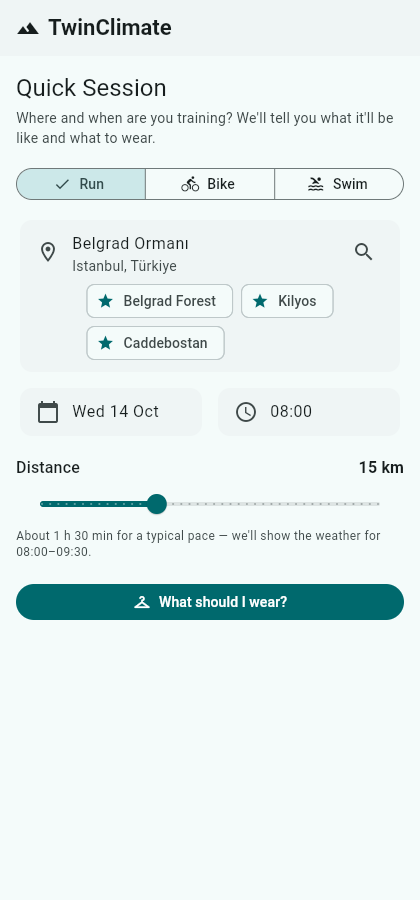
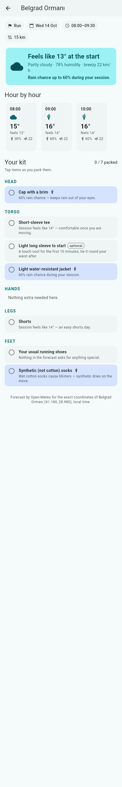

# TwinClimate 🏃🚴🏊

Training-session weather for outdoor athletes. Tell it **where**, **when**
and **how far** you're running, riding or swimming, and it answers with:

- an **hour-by-hour forecast for exactly your session window**, at the
  exact coordinates of your training spot (a forest outside the city is
  not the city centre);
- a "**feels like at the start**" summary with sky, humidity and wind;
- a **kit list** grouped by HEAD / TORSO / HANDS / LEGS / FEET, where
  **every item explains why it's suggested** ("70% rain chance during your
  session"). Rain- and wind-driven items are highlighted, and the list
  doubles as a tap-to-pack checklist.

| Plan a session | Conditions + kit |
| --- | --- |
|  |  |

*(Screenshots use sample weather.)*

Weather and place search come from [Open-Meteo](https://open-meteo.com)
— free, no account, no API key. Favourite places and last-used settings
are stored in the browser; nothing leaves the device.

Built with Flutter, runs in any web browser. Phone apps come later from
the same codebase.

## Roadmap

1. ✅ **Quick Session** — conditions + kit advice for a planned session.
2. ✅ **Target races** — save up to 3 races and get each one's typical
   race-day weather from 10 years of history, with separate swim / bike /
   run summaries.
3. ✅ **Race Matching** — find where and when, within travel range,
   conditions best match race day: top 5 places, each with a recommended
   time window and a match score, for a specific date or the best day in
   the next 7–14 days.
4. ✅ **Comfort profile** — after a session, a 2-tap question ("How did it
   feel?") teaches the app whether you run warm or cold, per body part and
   temperature; kit suggestions adapt and say why. Optional sliders in
   Settings.
5. **Packing reminder** — the kit checklist pings you the evening before.

## See it in your browser (GitHub Pages)

This repository ships with a workflow that builds the app and publishes it
to GitHub Pages automatically. One-time setup:

1. **Make the repository public** (GitHub Pages is not available on private
   repositories with GitHub's Free plan): on GitHub, open **Settings →
   General**, scroll to **Danger Zone → Change visibility → Make public**.
   *(Skip this step if the account has a paid plan.)*
2. Open the repository's **Actions** tab, choose **Deploy to GitHub Pages**
   in the left sidebar, and click **Run workflow**. (It also runs by itself
   on every future push.)
3. After the workflow turns green (~3 minutes), the app is live at:

   **https://yamackolatan.github.io/twinclimate/**

## Run it locally (for developers)

```bash
flutter pub get
flutter test       # gear engine, session window and app-flow tests
flutter analyze
flutter run -d chrome            # debug, hot reload
# or a production build:
flutter build web --release --no-web-resources-cdn
# then serve build/web with any static file server, e.g.:
python3 -m http.server 8080 -d build/web
```

Requires the [Flutter SDK](https://docs.flutter.dev/get-started/install)
(stable channel, 3.44+).

Product decisions, feature specs and the build order live in
[CLAUDE.md](CLAUDE.md).
