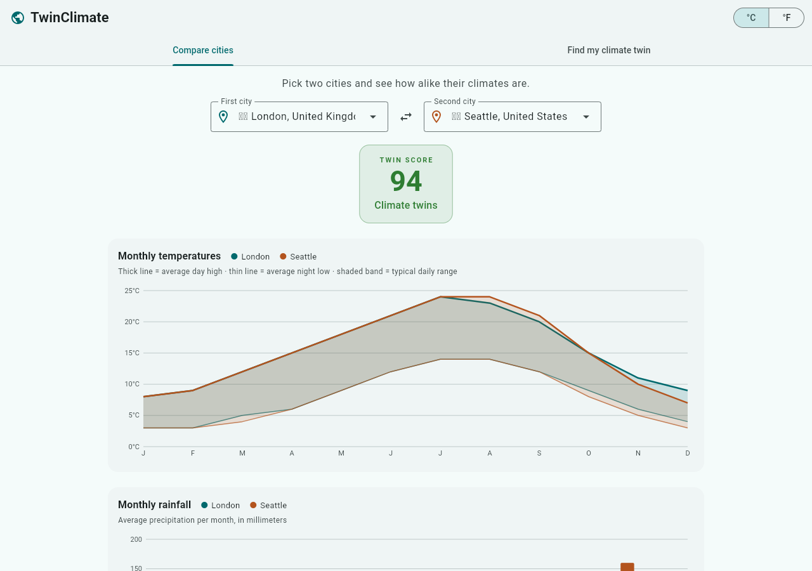
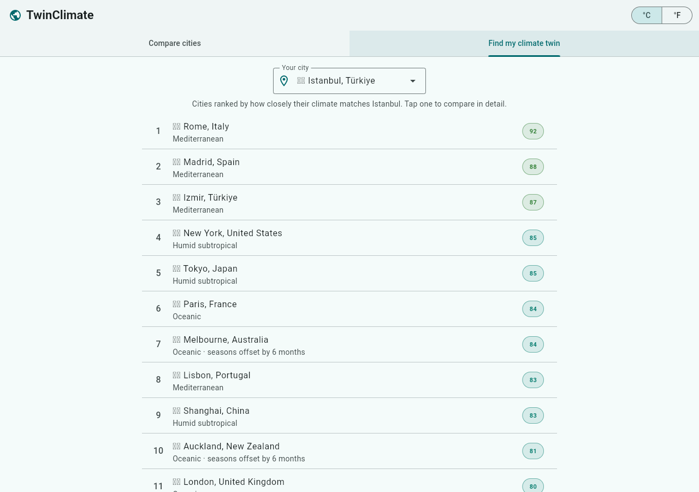

# TwinClimate 🌍

Ever wondered which city has the same weather as yours? TwinClimate compares
the climates of two cities month by month and finds your city's **climate
twin** — built with Flutter, runs in any web browser.

| Compare two cities | Find your climate twin |
| --- | --- |
|  |  |

## What it does

- **Compare cities** — pick any two of the 46 included world cities and see
  their monthly temperatures and rainfall side by side, plus a **Twin Score**
  from 0 (nothing alike) to 100 (identical climate).
- **Find my climate twin** — pick your city and get every other city ranked
  by how closely its climate matches. Cross-hemisphere twins are detected
  too (Cape Town and Los Angeles match with their seasons offset by
  6 months).
- **°C / °F toggle**, and a layout that works on phones and desktops.

Climate data is bundled with the app (approximate 1991–2020 climate
normals), so it needs no account, no API key, and no server.

## See it in your browser (GitHub Pages)

This repository ships with a workflow that builds the app and publishes it
to GitHub Pages automatically. One-time setup:

1. **Make the repository public** (GitHub Pages is not available on private
   repositories with GitHub's Free plan): on GitHub, open **Settings →
   General**, scroll to **Danger Zone → Change visibility → Make public**.
   *(Skip this step if the account has a paid plan.)*
2. Open the repository's **Actions** tab, choose **Deploy to GitHub Pages**
   in the left sidebar, and click **Run workflow**. (It also runs by itself
   on every future push.)
3. After the workflow turns green (~3 minutes), the app is live at:

   **https://yamackolatan.github.io/twinclimate/**

## Run it locally (for developers)

```bash
flutter pub get
flutter test
flutter run -d chrome            # debug, hot reload
# or a production build:
flutter build web --release --no-web-resources-cdn
# then serve build/web with any static file server, e.g.:
python3 -m http.server 8080 -d build/web
```

Requires the [Flutter SDK](https://docs.flutter.dev/get-started/install)
(stable channel, 3.44+). There are no other dependencies.

## Notes on the data

The bundled monthly normals (average daily high/low and precipitation) are
approximate values rounded from public climate-normal tables — fine for
comparing climates, not a source of record. The natural next step is wiring
in live data (e.g. the free [Open-Meteo](https://open-meteo.com) API) so any
city in the world can be searched; see `CLAUDE.md` for the plan.
